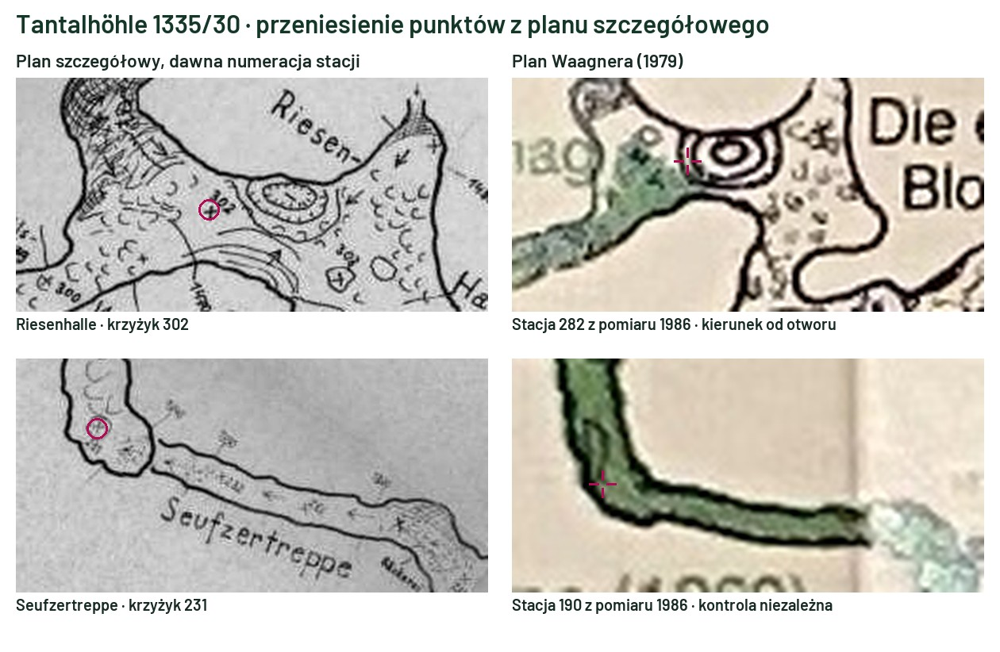

# Tantalhöhle 1335/30 · georeferencja planu z 1979 r.

Rzut W. Waagnera z 1979 r. opracowano według planów G. Abla, F. Koppenwallnera i W. Klappachera. Punkt GPX `Tantalhohle_30` (47,496138895° N, 13,080972182° E, 1710 m) odpowiada otworowi opisanemu „Eingang (1710)”. Punkt stały poligonu leży 0,74 m od tego zapisu GPX. [Fotografia planu](zrodla/plan-1979.jpg) · [Punkty GPX](../mapa/zrodla/Hagengebirge-2025-8.gpx)

Kadr ma 4032 × 1390 px. Z fotografii `IMG_4776.HEIC` zachowano wiersze od 620 do 2009. Transformacja metodą cienkiej płyty (TPS) dopasowuje 21 przecięć drukowanej siatki 500 m i koryguje perspektywę oraz zagięcia papieru. Początek siatki przypada przy otworze. Skala pozostaje zgodna z podziałką arkusza na całej mapie. Odbicie światła utrudnia odczyt detali w środkowej części fotografii. [Punkty siatki i transformacja](../scripts/tantal_plan.py)

## Kierunek i niezależna kontrola

W opracowaniu pomiaru z września 1986 r. Gadermayr identyfikuje stację 282 jako dawny punkt 302 z pomiaru Abla w Riesenhalle. Przy stacji 190 podaje dawny numer 231. Obie sygnatury zachowały się na szczegółowym rysunku. Dla 302 dopasowano pięć szczegółów wspólnych obu planom, w tym koncentryczny znak przy północnej ścianie sali, zwrot korytarza na północ od sali i ostro zakończony skraj jej południowego ramienia. Największa różnica między pięcioma parami szczegółów po lokalnym dopasowaniu podobieństwa wynosi około 4 px na fotografii Waagnera. Punkt 231 przeniesiono według obrysu zakrętu przy Seufzertreppe i sąsiedniego Wasserfallschacht. [Plan szczegółowy](https://github.com/dlubom/test2/blob/ec21231914280347e05cedd10d9e9aff55955d89/030-Tantalhohle/TANTALHOHLE_Plan.pdf) · [Wydruk Gadermayra, s. 9 i 13](https://github.com/dlubom/test2/blob/ec21231914280347e05cedd10d9e9aff55955d89/030-Tantalhohle/1/1335-0030_V_19860918_pol_Vermessung_Eingang-Riesenhalle_Ausarbeitung_Gadermayr.pdf)

| Funkcja | Dawny punkt / stacja 1986 | Piksel x, y w kadrze Waagnera | E, N na siatce planu od otworu [m] | E, N poprawionego modelu w UTM 33N [m] | Różnica na mapie |
|---|---|---|---|---|---:|
| Początek | Eingang / 0 | 126, 1197 | 0, 0 | 355462,73 / 5262084,82 | 0,74 m |
| Kierunek | Riesenhalle 302 / 282 | 2211, 810 | 1650,92 / 1371,02 | 357235,13 / 5263317,77 | 12,71 m |
| Kontrola | Seufzertreppe 231 / 190 | 1405,4 / 671,8 | 876,33 / 1095,52 | 356477,23 / 5263110,86 | 48,58 m |

Strzałka na planie Waagnera nosi oznaczenie „N” bez określenia rodzaju północy. Kiedy wskazuje północ geograficzną, różnica plan–poligon wynosi 131 m w Riesenhalle i 121 m przy Seufzertreppe. Kierunek od otworu do punktu 302 na poprawionym poligonie wyznacza **obrót rysunku o 3,47° w prawo** względem tego wariantu. Skalę ustala drukowana siatka. Odległość otwór–302 wynosi na planie 2146,0 m, a w poligonie 2159,4 m. Punkt 231 służy wyłącznie do sprawdzenia wyniku. Rozbieżność 49 m w tej części jaskini ogranicza dokładność odczytu położenia korytarzy na mapie. [Porównanie 282 odcinków pomiarowych z wydrukiem z 1986 r.](https://github.com/dlubom/test2/blob/ec21231914280347e05cedd10d9e9aff55955d89/030-Tantalhohle/1/kontrola-1986.md)

