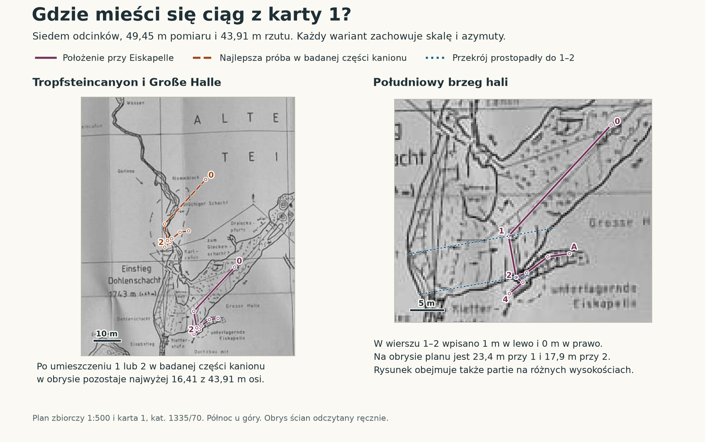
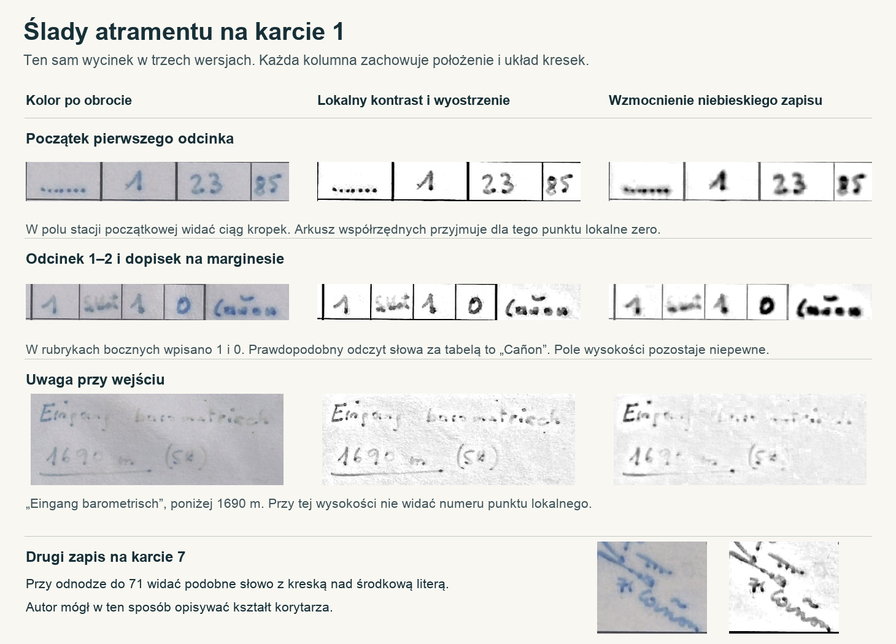
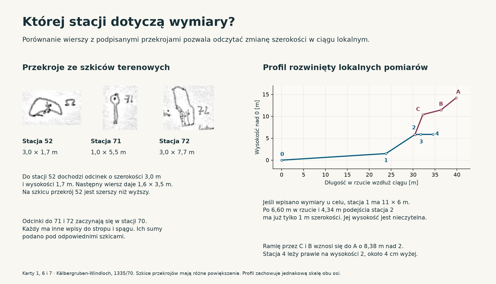
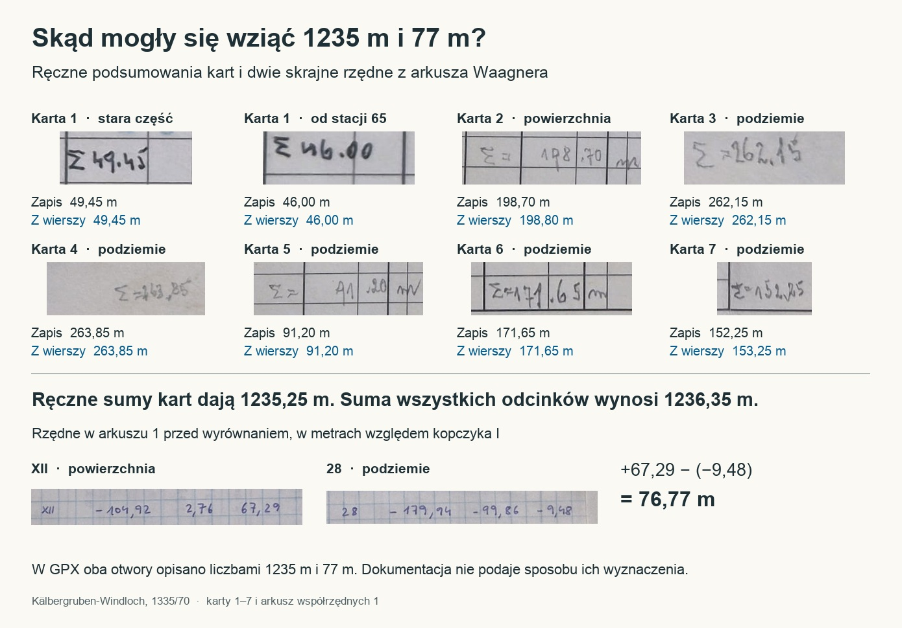
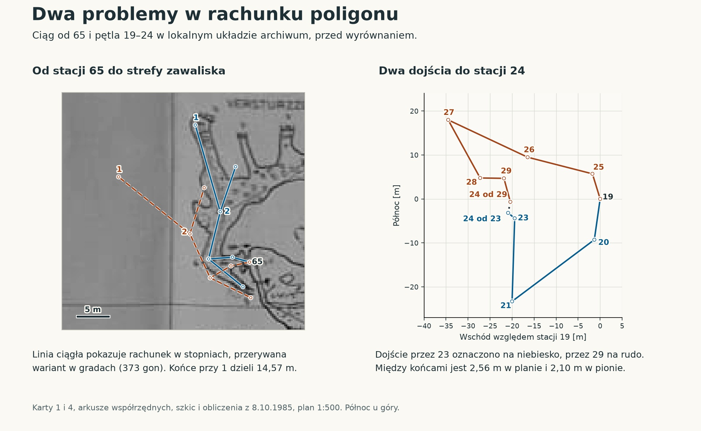

# Kälbergruben-Windloch · kontrola pomiarów ze skanów

**Ciąg 49,45 m pozostaje bez dowiązania.** Przy wierszu 1–2 karty 1 widnieje pominięty w transkrypcji dopisek, prawdopodobnie *Cañon*. Obserwator zapisał 1 m w lewo i 0 m w prawo. Sprawdziłem, gdzie przy zachowaniu zmierzonych azymutów można pomieścić długi odcinek 0–1, rozwidlenie przy 2 i taki wąski przekrój. [Karta 1](../zrodla/karta-1.jpg) · [Tabela wymiarów](../wymiary.tsv)

## Gdzie może leżeć ciąg lokalny



| Założenie | Ile z 43,91 m rzutu mieści się w obrysie starej części | Wynik |
|---|---:|---|
| Stacja 2 przy południowej odnodze Große Halle | 43,91 m (100%) | Krótkie ramiona pasują kształtem. Przy 1–2 obrys ma 23,4 m w stacji 1 lub 17,9 m w stacji 2. |
| Stacja 1 lub 2 w badanym odcinku nazwanego Tropfsteincanyon | najwyżej 16,41 m (37,4%) | Nawet najkorzystniejsze przesunięcie umieszcza większą część osi poza obrysem. |
| Stacja 1 lub 2 w strefie wylotu kanionu przy Dohlenschacht | najwyżej 30,49 m (69,4%) przy 1 lub 27,94 m (63,6%) przy 2 | Rozszerzenie obszaru ku hali poprawia dopasowanie. |
| Lokalna 1 = główna 1 albo lokalna 4 = główna 2 | odpowiednio 41,89 m (95,4%) i 40,24 m (91,7%) | Każda para narzuca inne przesunięcie ciągu. |
| Lokalne 0 w dolnym E1 albo górnym E2 | odpowiednio 7,51 m (17,1%) i 2,56 m (5,8%) | W obu przypadkach większość ciągu wychodzi poza odczytany obrys. |

Przy południowej odnodze plan ma podpis *unterlagernde Eiskapelle*, wskazujący na położoną niżej komorę. Szczelina wewnątrz hali albo przejście na innym poziomie mogą dać w terenie znacznie mniejszy przekrój. Na rycinie 276 z 1963 r. nazwa *Tropfsteincanyon* odnosi się do korytarza na północ od hali. W dopisku na karcie 1 brak członu *Tropfstein*. Rycina pokazuje też południową odnogę, lecz nie wskazuje wysokości ani punktów lipcowego pomiaru. [Plan 1:500](../zrodla/plan-1-500.jpg) · [Rycina 276 i opis jaskini](../zrodla/hoehlenbuch/s-304.jpg) · [Porównanie obu rysunków](lokalny-ryc276.jpg)

**Kontrola szerokości.** Przekrój prostopadły do rzutu odcinka sprawdziłem na obu jego końcach. Spośród 1021 położeń, w których cała oś mieściła się w obrysie, minimalna szerokość przy 1–2 wyniosła 23,0 m na początku albo 3,9 m na końcu. W żadnym z tych położeń obrys nie odtworzył zapisanego 1 m. Wynik zależy od ręcznego odczytania zewnętrznych ścian. Nie znamy dokładnego miejsca i kierunku pomiaru szerokości w terenie ani przekroju na wysokości instrumentu. [Interaktywna nakładka](lokalny-na-planie.html)

**Kontrola wspólnych stacji.** Przy utożsamieniu lokalnej 1 z główną 1 lokalne zero musiałoby mieć wysokość +40,24 m względem kopczyka I. Para lokalna 4 i główna 2 wymaga +36,82 m. Przesunięcia różnią się o 3,42 m w pionie i około 3,54 m w poziomie. Drugi ślad to lokalne 0–1 i główne 17–18. Oba mają azymut 249 gon i długości 23,85 i 23,90 m, lecz nachylenia wynoszą +4 i −4 gon. Po nałożeniu początków końce dzieli tylko 0,05 m w rzucie, ale 3,00 m w pionie. Karta 3 i obliczone rzędne potwierdzają znak minus. Osobne zero w archiwalnym bloku lokalnym oraz barometryczne 1690 m opisane przy wejściu nie wyznaczają wysokości tego zera. [Karta 1](../zrodla/karta-1.jpg) · [Karta 3](../zrodla/karta-3.jpg) · [Arkusz z lokalnym zerem](../zrodla/wspolrzedne-2.jpg)

Do przeliczenia użyłem siatki 50 m i maski ścian z istniejącej nakładki. Zmieniałem wyłącznie przesunięcie E, N na siatce co 0,25 m. Próbki wzdłuż osi są odległe o najwyżej 0,16 m. Procenty uwzględniają długość odcinków. W teście kanionu wymagałem położenia stacji w masce między x = 1040 i 1198 px, przy 140 ≤ y < 345 px. Dla wylotu przyjąłem 345 ≤ y < 400 px. Piksele odnoszą się do fotografii 2000 × 924 px po obrocie w lewo. Szerokości liczono do pierwszego wyjścia z maski w obie strony, krokiem 0,1 m. [Skrypt kontroli obrysu](sprawdz_obrys.py)

## Co odsłoniła obróbka fotografii



Na kopiach 12 fotografii dobrałem orientację do treści. Dla kart 1–5 i planu to obrót w lewo, dla kart 6–7 o 180°, a dla październikowego arkusza obliczeń w prawo. Szkic i oba lipcowe arkusze współrzędnych były już ustawione pionowo. Wyrównałem tło lokalnie w oryginalnej rozdzielczości (filtr Gaussa, σ = 16 px) i zastosowałem maskę wyostrzającą o promieniu 1,1 px. Osobno wzmocniłem nadwyżkę niebieskiego nad czerwonym kanałem względem miejscowego tła. Zapis w pierwszej komórce nadal składa się z kropek. Notatkę o 1690 m poprzedzają słowa *Eingang barometrisch*. W arkuszu współrzędnych czytelne są końcówka *…vermessung (lokal)* i osobny wiersz zer. Nie udało się rozstrzygnąć początku tego wyrazu ani odczytać wymiaru do stropu przy 1–2. [Karta 1](../zrodla/karta-1.jpg) · [Arkusz 2](../zrodla/wspolrzedne-2.jpg)

Na szkicu karty 7 przy krótkiej odnodze do 71 występuje podobny zapis z kreską nad środkową literą. To dodatkowa przesłanka za odczytem *Cañon* oraz za tym, że obserwator używał tego słowa do opisu formy korytarza w więcej niż jednym miejscu. [Karta 7](../zrodla/karta-7.jpg)



**Wymiary najprawdopodobniej wpisywano przy celu pomiaru.** Na karcie 7 wiersz 70–71 daje 1,0 × 5,5 m, a 70–72 daje 3,0 × 7,7 m. Oba pomiary zaczęto w 70, lecz wpisano różne odległości do stropu i spągu. Rysunki przy 71 i 72 pokazują dwa różne, wysokie przekroje. Na karcie 6 przekrój 52 jest szerszy niż wyższy, zgodnie z wierszem dochodzącym (3,0 × 1,7 m). Wychodzący daje 1,6 × 3,5 m. Nie każdy szkic rozstrzyga sprawę. Na przykład w 45 oba wiersze dają po 1,7 × 0,7 m, a dla 55 proporcje sylwetki lepiej pasują do wiersza wychodzącego. [Karta 5](../zrodla/karta-5.jpg) · [Karta 6](../zrodla/karta-6.jpg) · [Karta 7](../zrodla/karta-7.jpg)

Przy tej interpretacji na karcie 1 trzeba szukać **przejścia z przestrzeni szerokiej na 11 m i wysokiej na 6 m przy stacji 1 do zwężenia o szerokości 1 m przy stacji 2**. Na przejściu między nimi jest 6,60 m w rzucie i 4,34 m podejścia. W 2 ciąg się rozdziela. Krótkie ramię do 4 wznosi się jeszcze o 4 cm i przy końcu ma 0,4 m szerokości. Drugie ramię wznosi się do A o 8,38 m. Te wysokości wynikają z pomiarów niezależnie od przypisania przekrojów. [Karta 1](../zrodla/karta-1.jpg) · [Lokalne współrzędne](wspolrzedne-archiwalne.tsv)

**Próba z górną odnogą na innym piętrze.** Pozwoliłem ramieniu 2–C–B–A wyjść poza odczytany obrys. Wewnątrz musiały się zmieścić tylko cztery boki 0–1–2–3–4 o łącznym rzucie 34,51 m. Na siatce co 0,25 m dało to 1672 położenia zamiast 1021. Na gęstszej siatce co 0,10 m było 10 460 położeń. Najmniejsza szerokość z obrysu w stacji 2 wyniosła wówczas 3,7 m wobec 1 m w dzienniku. Przy najbardziej zgodnym łącznie zestawie czterech przekrojów model dał 23,1 / 3,7 / 6,0 / 0,3 m przy zapisanych 11 / 1 / 1 / 0,4 m (kryterium najmniejszej maksymalnej różnicy). To test istniejącego obrysu i kierunku prostopadłego do celowej. Wewnętrznej szczeliny i przebiegu na innym piętrze nie da się nim wykluczyć. [Powtarzalny test geometrii](sprawdz_obrys.py)

Sprawdziłem też obrót **samego lokalnego poligonu o 200 gon** w poziomie jako próbę wyjaśnienia podobieństwa do głównego odcinka 17–18. Gdy nałożyć 0 na główną 18, lokalna 1 wypada 0,05 m od głównej 17 w przestrzeni. Przy następnej parze, lokalnej 2 i głównej 16, rozbieżność rośnie do 2,07 m. Sam obrót odwraca znaki obu poziomych składowych względem zapisanych w tabeli lokalnej. Sprawdziłem również małą wstawkę w prawym dolnym rogu planu. W skali głównej siatki sam odcinek 0–1 miałby tam około 86 px, a dolny rysunek wstawki ma około 25 × 53 px. Jej własnej skali i oznaczeń punktów nie udało się odczytać. [Arkusz lokalny](../zrodla/wspolrzedne-2.jpg) · [Plan 1:500](../zrodla/plan-1-500.jpg)

Dokumentem, który mógłby rozstrzygnąć dowiązanie, byłby szkic starej części z 20 lipca 1985 r. z oznaczeniami **2, C, B, A** oraz wspólną stacją głównego pomiaru. Rozpoznawalny szczegół planu dałby położenie poziome, a rzędna opisana względem kopczyka I pozwoliłaby dodatkowo ustalić wysokość. Jako późniejsze źródło bibliograficzne sprawdziłem też tom 6 *Salzburger Höhlenbuch* z 1996 r., zawierający uzupełnienia do tomów 1–5. Katalog potwierdza istnienie tomu. Nie ustaliłem, czy zawiera wpis o jaskini 1335/70. [Deutsche Nationalbibliothek, rekord tomu 6](https://d-nb.info/954522540)

[Pytania do osoby, która była w jaskini, z planem do zaznaczenia trasy (Word)](pytania-o-stara-czesc.docx)

## Skąd mogły się wziąć 1235 m i 77 m w GPX



- **Długość.** Ręczne podsumowania obu serii z karty 1 i kart 2–7 dają 1235,25 m. Po dodaniu 111 odcinków pojedynczo wychodzi 1236,35 m. Na karcie 2 ręcznie wpisano 198,70 m przy sumie 198,80 m, a na karcie 7 wpisano 152,25 m przy sumie 153,25 m. Po odjęciu 198,80 m pomiaru powierzchniowego zostaje **1037,55 m zapisanych odcinków podziemnych**. To 988,10 m w głównym modelu i 49,45 m w osobnym ciągu. [Karta 2](../zrodla/karta-2.jpg) · [Karta 7](../zrodla/karta-7.jpg)
- **Wysokość.** Przed wyrównaniem najwyższa rzędna sieci głównej to +67,29 m na powierzchniowej XII, najniższa −9,48 m w podziemnej 28. Rozpiętość wynosi 76,77 m. Od górnego otworu E2 do 28 było przed wyrównaniem 72,52 m. Po wyrównaniu pętli najniżej leży 79, a rozpiętość podziemnego modelu E2–79 wynosi 71,59 m. [Arkusz współrzędnych 1](../zrodla/wspolrzedne-1.jpg) · [Arkusz współrzędnych 2](../zrodla/wspolrzedne-2.jpg)

Oba wpisy otworów w GPX podają 1235 m i 77 m. Obie liczby odtwarzają się po zaokrągleniu rachunku obejmującego powierzchnię. To możliwe wspólne źródło obu wartości. GPX nie podaje sposobu obliczenia. Z różnicy między 1235 m a sumą pomiarów podziemnych nie można wyznaczyć długości brakującego korytarza. [Źródłowy GPX, wpisy Kalbergrube_70-d i Kalbergrube_70-g](../../mapa/zrodla/Hagengebirge-2025-8.gpx)

## Jednostki ciągu od 65 i błąd pętli



**Odgałęzienie od 65 ma udokumentowane dowiązanie.** Na szkicu jest *Anschluss (P. 65)* i przepisane współrzędne 65. Wątpliwość dotyczy jednostki kątowej. Na formularzu obliczeń ukośne kreski przecinają pola ±90° i 360°, a pola ±100 gon i 400 gon są bez kresek. Liczba 373 pojawia się na karcie, szkicu i arkuszu. Wiersz 4–2 daje w arkuszu +1,76 m na wschód i +7,64 m na północ. Taki kierunek daje 373° = 13°. Przy 373 gon i nachyleniu +7 gon wychodzi **3,23 m na zachód** i **7,16 m na północ**, czyli skręt na przeciwną stronę północy. [Karta 1](../zrodla/karta-1.jpg) · [Oryginalny szkic](../zrodla/1985-10-szkic.jpg) · [Arkusz obliczeń i oznaczenia jednostek](../zrodla/1985-10-obliczenia.jpg)

Od tej samej archiwalnej stacji 65 wariant stopniowy daje w punkcie oct.1 pozycję E = −346,38 m, N = +79,08 m, a gradowy E = −358,37 m, N = +70,81 m. **Różnica w planie wynosi 14,57 m.** Główny model prowadzi ciąg w stopniach, zgodnie z archiwalnymi składowymi i planem. Plan mógł powstać z tego samego rachunku. Jednostka rzeczywiście użyta podczas odczytu instrumentu pozostaje nieustalona. Jest też omyłka w ostatnim dodawaniu wysokości dla oct.5. Z zaokrąglonych liczb arkusza wynika 11,52 − 2,57 = 8,95 m, podczas gdy wpisano 8,99 m. [Arkusz październikowy](../zrodla/1985-10-obliczenia.jpg) · [Model Survex](../pomiary.svx)

**Pętla 19–24.** Od 19 przez 20, 21 i 23 jest 61,90 m, a przez 25, 26, 27, 28 i 29 jest 70,05 m. Koniec drugiej drogi wypada 0,51 m dalej na wschód, 2,51 m dalej na północ i 2,10 m niżej. Daje to 2,56 m w rzucie i 3,31 m w przestrzeni (2,51% z 131,95 m). Obie pozycje 24 zapisano już w historycznym arkuszu. Sprawdziłem też zmianę długości każdego z dziesięciu odcinków osobno, zachowując oba kąty i pozostałe pomiary. Nawet najkorzystniejsza hipotetyczna zmiana, z 11,00 m na 7,72 m w odcinku 19–20, pozostawia 0,48 m błędu. Karta wyraźnie podaje 11,0 m, co potwierdza też pozycja 20. [Karta 4](../zrodla/karta-4.jpg) · [Dwie pozycje stacji 24](../zrodla/wspolrzedne-1.jpg) · [Wynik wyrównania Survex](../../hagen.err)

Przy tej samej stacji 19 zaczynają się dwa podobne odcinki. Na karcie 4 do 25 zapisano 7,0 m, −35 gon, 381 gon. Na karcie 7 do 66 zapisano 7,6 m, −37 gon, 387 gon. Z tych obserwacji ich końce dzieli **0,70 m w poziomie i 0,52 m w pionie**, razem 0,87 m. Dalej z 25 i z 66 wychodzą inne odcinki. Oba numery występują osobno w arkuszach. [Karta 4](../zrodla/karta-4.jpg) · [Karta 7](../zrodla/karta-7.jpg)

## Zakres sprawdzenia

Porównanie ze skanami objęło 98 lipcowych odcinków głównej sieci, 7 lokalnych i 6 od stacji 65. Sprawdziłem numery, długości, znaki nachyleń i azymuty. W tabeli wymiarów odnotowałem obecność dopisku przy 1–2 oraz wpisałem czytelne słowa *Schluf* przy 49–50 i *Kluft* przy 50–51. Proponowany odczyt *Cañon* pozostaje hipotezą. Nieczytelne pola zachowują oznaczenia niepewności. [Karty i arkusze](../zrodla/) · [Wymiary](../wymiary.tsv)

Składowe obliczone ze wzorów ΔE = L cos i sin A, ΔN = L cos i cos A, ΔH = L sin i porównałem ze 112 wpisami archiwalnymi, rozdzielając oba dojścia do 24. Maksymalne odstępstwa przestrzenne wyniosły 1,4 cm w głównym ciągu lipcowym, 0,8 cm w lokalnym i 2,9 cm w odgałęzieniu od 65, licząc od niezaokrąglonej lipcowej pozycji tej stacji. Wiersz stacji 12 jest poza czytelnym kadrem. Suma wektorów od 11 przez 12 do 13 zgadza się z różnicą pozycji 11 i 13 do 0,9 cm. Zgodność z dawnym rachunkiem pozwala sprawdzić transkrypcję. Błąd terenowy może występować zarówno w karcie, jak i w obliczonych z niej współrzędnych. [Tabela kontrolna](wspolrzedne-archiwalne.tsv)

Oba testy można powtórzyć w katalogu głównym. Pierwszy używa programów `cavern` i `dump3d`, które zapisują i wypisują pozycje modelu zaokrąglone do centymetra. Drugi wymaga NumPy i Pillow.

```sh
python3 1335-70/kontrola/sprawdz.py
python3 1335-70/kontrola/sprawdz_obrys.py
```
