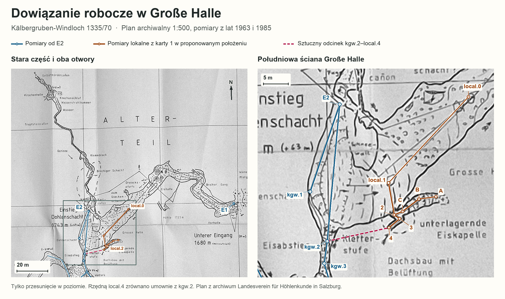

# Gdzie na planie mieści się ciąg 49,45 m?

**Najlepszym miejscem do sprawdzenia jest rozwidlenie na południowej ścianie Große Halle**, pomiędzy podpisami *Dachsbau mit Belüftung* i *unterlagernde Eiskapelle*. Proponowana stacja `local.2` wypada około **14,5 m w rzucie od `kgw.2`**, w kierunku wschodnio-północno-wschodnim. Numerów lipcowych stacji ani rzędnej tego rozwidlenia nie ma na planie. [Główny model do Aven](../../hagen.3d) · [Źródło Survex z opisem łącznika](../lacznik-grosse-halle.svx) · [Ruchoma nakładka](lokalny-na-planie.html)

## Dopasowanie do większej fotografii

Na planie 1:500 krótki zygzak od ściany hali ma w rzucie około **1,6 m i 138 gon**, a po załamaniu **2,9 m i 253 gon**. Na karcie 1 kolejne celowe 2–3 i 3–4 mają w rzucie **1,30 m i 141 gon** oraz **2,80 m i 256 gon**. W tym samym ustawieniu drugie ramię, 2–C–B–A, biegnie w stronę ślepej odnogi na wschodzie. Stacja A wypada około **2,2 m** od jej narysowanego końca. Ten koniec posłużył do sprawdzenia dopasowania. Określenie *unterlagernde Eiskapelle* wskazuje niżej położoną komorę. Przynależność obu ramion do tego samego piętra wymaga sprawdzenia. [Karta 1](../zrodla/karta-1.jpg) · [Oryginalny plan](../zrodla/plan-1-500.jpg)

Na fotografii 4000 × 1848 px, w orientacji zgodnej z napisami, ręcznie wskazano miejsca dla 2, 3 i 4, odpowiednio około (2453, 950), (2463, 956) i (2447, 970) px, licząc od lewego górnego rogu. Użyto transformacji pomiędzy fotografiami oraz interpolacji na drukowanej siatce 50 m. Średnia z trzech przesunięć daje dla `local.0` **E = −71,3 m, N = −3,2 m** względem kopczyka I, przy zachowaniu skali i kierunków z karty. Odstępy od trzech wybranych miejsc na rysunku wynoszą około 0,1–0,3 m. To miara dopasowania kreski, a dokładność przeniesienia w teren pozostaje nieznana. Różnica względem wcześniejszej próby przy tej ścianie wynosi 0,47 m. [Kalibracja obu fotografii](../../scripts/build_map_data.py)

W tym ustawieniu około **43,4 z 43,9 m** rzutu mieści się w uprzednio odczytanym obrysie. Końcówka 3–4 wychodzi poza maskę o około 0,47 m **długości odcinka**. Jeśli odległości do ścian odnoszą się do celu, przy stacji 2 karta podaje 1 m szerokości, a przecięcie maski prostopadle do celowej daje około 3,5 m. Przy stacji 1 dla celowej dochodzącej 0–1 jest odpowiednio 11 m i 21,9 m. Wynik przy 2 jest szczególnie wrażliwy na to, po której stronie narożnika przetnie się obrys. Starsza rycina różni się w tej okolicy o kilka metrów. Te rozbieżności ograniczają pewność identyfikacji. [Kontrola obrysu](sprawdz_obrys.py) · [Rycina z 1963 r.](../zrodla/hoehlenbuch/s-304.jpg)

## Łącznik i kontrola terenowa

W głównym modelu połączono stacje **`kgw.2 → local.4`** sztucznym bokiem oznaczonym „do weryfikacji w terenie”. W historycznym układzie lipcowym przyjęto **ΔE = +12,45 m, ΔN = +2,58 m**, czyli 12,71 m w rzucie przy azymucie około 87 gon. **ΔH = 0 m jest założeniem**. Obie stacje mają zatem w modelu wysokość 1703,71 m, a przy archiwalnej rzędnej `kgw.2` równej +42,70 m lokalne zero wypada na +36,82 m względem I. Linia reprezentuje przesunięcie między sieciami, a jej prosty przebieg przez ten sektor nie ma dokumentacji terenowej. Flaga Survex `duplicate` wyłącza łącznik z sumy. Łączna długość zmierzonych odcinków podziemnych w tej kompilacji wynosi **1037,55 m**. [Model do Aven](../../hagen.3d) · [Plik wejściowy](../lacznik-grosse-halle.svx)

W terenie punktem odniesienia jest główna `kgw.2`, cel z XIII (E2) na karcie 3. W pasie południowej ściany hali należy rozpoznać krótki zygzak do 4 oraz drugie ramię, które od 2 do A wznosi się o 8,38 m. Rozwidlenie `local.2` wypada około 13,6 m na wschód i 5,1 m na północ od `kgw.2` w siatce lipcowej. Najważniejszy jest rzeczywisty pomiar od rozpoznanej stacji głównej do rozwidlenia lub końca 4, z różnicą wysokości i szkicem prowadzenia celowych. Pozwoli zastąpić sztuczny bok i sprawdzić piętro obu odnóg. [Karta 3](../zrodla/karta-3.jpg)

Plan pokazuje osobno drogę od dolnego E1 przez *Vorhalle*, *Breiter Gang* i *Eishalle* do Große Halle. Karty nie zawierają ciągu przez te partie. Również północny kanion ma dalszy przebieg ku *Hirschenhalle*. Sztuczny bok dotyczy wyłącznie umiejscowienia siedmiu odcinków z karty 1. [Plan 1:500](../zrodla/plan-1-500.jpg)

## Wcześniejsze ustawienia w obrysie starej części

### Próba ze stacją 2 w wylocie odnogi

W starszej próbie ze stacją 2 przy wylocie odnogi najdłuższy odcinek 0–1 biegnie przez Wielką Salę. Od stacji 2 krótkie ramię 2–3–4 załamuje się wraz z narysowaną odnogą, a drugie, 2–C–B–A, podąża na północny wschód. Punkt A wypada około 2 m od końca widocznego na planie. Początek ciągu 0 leży wtedy około 72 m na zachód i 3 m na południe od I. Najbliższa para obu sieci, lokalna 4 i główna `kgw.2`, jest oddalona w poziomie o 12,3 m. [Plan 1:500](../zrodla/plan-1-500.jpg) · [Współrzędne lokalne z dziennika](wspolrzedne-archiwalne.tsv)

Na karcie 1 widnieje dopisek o starej części oraz wysokość barometryczna wejścia 1690 m. Pierwszy punkt nie ma numeru stacji głównego ciągu. Arkusz obliczeń przyjmuje dla niego osobne zero. Stacja A znajduje się 8,38 m powyżej lokalnej 2. Książka wspomina o szczelinowym oknie na wysokości około 10 m w rejonie studni, ale nie podaje położenia wystarczającego do powiązania go z punktem A. [Karta 1](../zrodla/karta-1.jpg) · [Arkusz z lokalnym zerem](../zrodla/wspolrzedne-2.jpg)

## Jak sprawdzono pozostałe położenia

Siedem odcinków daje 49,45 m długości przestrzennej i 43,91 m w rzucie poziomym. Na planie zbiorczym kalibrację wyznaczają przecięcia drukowanej siatki co 50 m. Zachowano skalę i azymuty pomiaru, zmieniając wyłącznie położenie w poziomie. Obrys starej części odczytano ręcznie. Wzdłuż osi rozmieszczono próbki w odstępach do 0,16 m i sprawdzono także końce odcinków. Wartości w tabeli zależą od odczytu ścian, szczególnie na progach i w partiach nakładających się w rzucie.

| Ustawienie ciągu | Część długości rzutu wewnątrz odczytanego obrysu | Co widać na planie |
|---|---:|---|
| 2 przy bocznej odnodze | 100% | Oba krótkie ramiona podążają po narysowanym rozwidleniu. |
| 0 w środku sali, 79,75 m na zachód od I | 100% | Rozwidlenie pomiaru przypada w otwartej przestrzeni Wielkiej Sali. |
| 0 w dolnym otworze E1 | 17% | Skrajne wyjście poza obrys wynosi około 20,5 m. |
| 0 w górnym otworze E2 | 6% | Skrajne wyjście poza obrys wynosi około 10,6 m. |
| Lokalna 4 na głównej `kgw.2` | 92% | Część krótkiego ramienia wychodzi poza obrys, do około 1,35 m. |

W siatce przesunięć co 0,25 m znaleziono 1021 położeń zera, dla których cały przebieg mieści się w obrysie. Z kolei wśród 736 par utworzonych z ośmiu stacji lokalnych i 92 stacji odniesienia żadna nie dawała pełnej zgodności z odczytanym obrysem. Samo dopasowanie do szerokiej sali nie wystarcza do identyfikacji stacji. W nakładce można zmieniać wariant, przesuwać ciąg i wyświetlić dopuszczalne położenia zera. [Otwórz nakładkę](lokalny-na-planie.html)

## Co wnosi rycina 276 z 1963 r.

Na stronie 304 *Salzburger Höhlenbuch* małe rozwidlenie jest widoczne przy tym samym brzegu Wielkiej Sali. Położenie poligonu przeniesiono z planu zbiorczego na fotografię strony za pomocą transformacji afinicznej według sześciu szczegółów ścian, z pominięciem badanego rozwidlenia. Przeniesiona stacja 2 wypada około **6 m** od wylotu odczytanego na rycinie. Oba rysunki wykorzystują pomiar z 1963 r., a ich obrysy miejscami się różnią. Rycina pomaga rozpoznać odnogę, lecz nie podaje numerów stacji ani jej rzędnej. [Porównanie z ryciną 276](lokalny-ryc276.jpg) · [Oryginalna strona 304](../zrodla/hoehlenbuch/s-304.jpg) · [Przekład](../zrodla/hoehlenbuch/tlumaczenie-pl.md)

Punkty użyte do porównania obu rysunków

Współrzędne w pikselach liczone od lewego górnego rogu. Fotografię planu 1:500 obrócono o 90° w lewo (2000 × 924 px). Zdjęcie strony 304 zachowało oryginalną orientację (1200 × 1600 px).

| Szczegół obrysu | Plan 1:500 (x, y) | Strona 304 (x, y) |
|---|---:|---:|
| Załamanie północnej ściany hali przy Dohlenschacht | 1210, 400 | 540, 634 |
| Początek bocznej szczeliny na północnym brzegu hali | 1265, 333 | 634, 524 |
| Północny wierzchołek Eishalle | 1368, 265 | 849, 385 |
| Południowo-zachodni koniec wyspy skalnej pod Eishalle | 1319, 343 | 745, 529 |
| Południowy koniec obrysu Dohlenschacht | 1172, 478 | 489, 789 |
| Ślepa północna odnoga w zakręcie na wschód od Eishalle | 1421, 285 | 934, 425 |

Przy tych punktach stacja 2 z pozycji (1218, 465) na planie zbiorczym przechodzi na (570, 760) na fotografii książki. Wylot bocznej odnogi odczytano na niej w przybliżeniu w (592, 714). Odległość około 51 px przeliczono z podziałki 0–50 m na rycinie.

